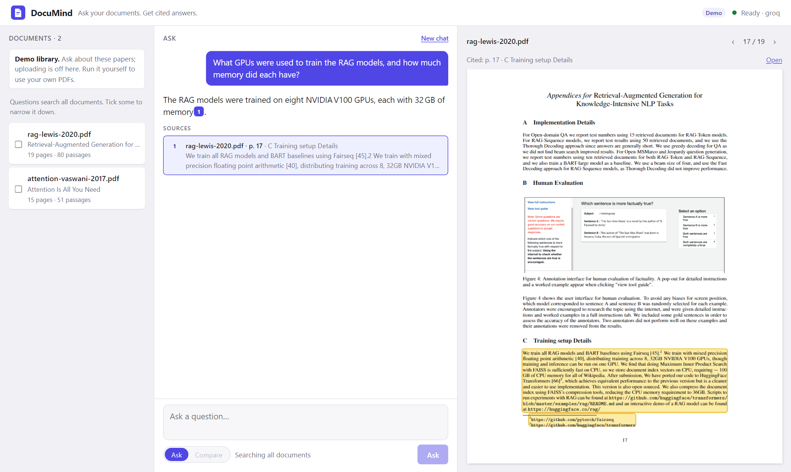
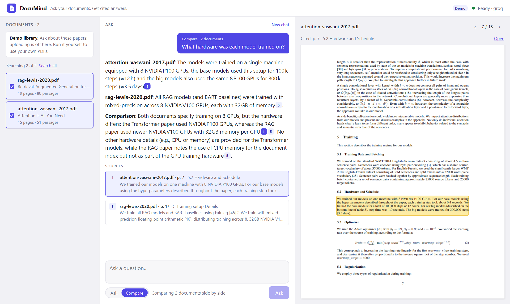

# DocuMind

Ask questions about your PDFs (research papers, reports, company documents) and get answers that cite the exact page and passage they came from.

Built with the **MERN** stack: MongoDB Atlas (documents, chunks and vectors in one database), Express, React and Node.

**Live demo: <https://documind-1htu.onrender.com>** (read-only, with two research papers loaded)

> The demo runs on free tiers (Render, MongoDB Atlas, Groq), so the first visit after a quiet spell takes about a minute to wake up, and answers take 10–20 seconds. Running it locally is much faster.





## Results

Measured on two arXiv papers ("Attention Is All You Need" and the original RAG paper) with 23 questions they answer and 5 they don't. Full report: [server/eval/RESULTS.md](server/eval/RESULTS.md).

**Retrieval** (no LLM involved):

| | Vector search only | Hybrid + rerank (final) |
|---|---|---|
| Right passage ranked first (Hit@1) | 61% | **83%** |
| Right passage in top 3 (Hit@3) | 78% | **96%** |
| Mean reciprocal rank | 0.70 | **0.89** |

**Answers**, with two free LLMs:

| | Llama 3.2 3B (local), vector only | Llama 3.2 3B (local), final | gpt-oss-120b (Groq free tier), final |
|---|---|---|---|
| Correct answers | 83% | 96% | **96%** |
| Correct and citing a supporting passage | 74% | 83% | **96%** |
| Citation precision | 80% | 75% | **87%** |
| Unanswerable questions refused | 100% | 100% | **100%** |
| Answerable questions wrongly refused | 4% | 0% | **0%** |

The evaluation also found and fixed real problems: papers' own reference markers ("FAISS [23]") being copied into answers as fake citations, rotated arXiv margin text being read as the title, and a relevance cutoff that never rejected an on-topic but unanswerable question. Small set, so treat differences under ~10 points as noise ([caveats](server/eval/RESULTS.md#caveats)).

## How it works

```
PDF ─► pdfjs-dist ─► text blocks ─► section-aware ─► local embeddings ─► MongoDB Atlas
       (page + position   (headings,      chunks          (bge-small,          (vector + text
        of every block)    no headers/    (≤1200 chars,    transformers.js)     index)
                           footers)        never cross
                                           a heading)

Question ─┬─► $vectorSearch (meaning) ──┐
          │                             ├─► RRF merge ─► rerank ─► relevance gate ─► LLM (Claude / Ollama) ─► answer
          └─► $search BM25 (exact terms)┘   (top 20)    (top 6,   (too weak? say      forced to cite [n]      + sources
                                                         cross-    "I don't know")                            (file, page, quote)
                                                         encoder)
```

- **Hybrid search.** Vector search finds passages with the same *meaning*. Keyword search (BM25) finds *exact terms*: names, codes, numbers and acronyms that embeddings blur. The two ranked lists are merged with Reciprocal Rank Fusion, so passages found by both rank highest. Set `SEARCH_MODE=vector` or `keyword` to compare.
- **Reranking.** A local cross-encoder (ms-marco MiniLM) reads the question and each of the top 20 passages together and reorders them by how well they answer it. Clearly irrelevant passages are dropped before the LLM sees them, because a small model tends to cite whatever is in its prompt. Set `RERANK=false` to compare.
- **Grounded answers.** The model sees numbered sources and must cite one for every claim. Citations are parsed and mapped back to a file, page range and passage. An answer with no citations, or with a citation to a source that doesn't exist, is flagged.
- **Says "I don't know".** Two checks run before the LLM is called: the best passage must be similar enough (vector score), and the reranker must judge that it actually answers the question. The model is also told to refuse when the sources don't contain the answer.
- **Click a citation, see the passage.** Every chunk stores the page rectangles it came from, so the PDF viewer opens the cited page with the passage highlighted.
- **Compare documents.** Tick 2–4 documents and switch to *Compare*: each document is searched separately (so one can't crowd out the others), and the answer covers each document and then their similarities and differences, with citations. Documents that don't cover the question are flagged instead of guessed at.
- **Measured, not assumed.** An evaluation set with retrieval and answer metrics (`npm run eval`) backs every change above with numbers.
- **Free to index.** Embeddings run locally in Node, so indexing needs no API key.
- **Pluggable LLM.** Claude (`claude-opus-5-5`), Groq's free tier (`openai/gpt-oss-120b`, used for the online demo), or a free local model through Ollama.

## Setup

Requirements: Node 20+ and a free MongoDB Atlas account.

### 1. MongoDB Atlas (free tier)

1. Sign up at <https://www.mongodb.com/cloud/atlas/register> and create a free **M0** cluster.
2. **Database Access**: add a database user with a password.
3. **Network Access**: add your IP address (or `0.0.0.0/0` while developing).
4. **Connect → Drivers**: copy the connection string.

### 2. Configure

```bash
cd server
npm install
cp .env.example .env     # Windows PowerShell: Copy-Item .env.example .env
```

Edit `server/.env`:
- `MONGODB_URI`: your Atlas connection string (with the password filled in)
- `ANTHROPIC_API_KEY`: from <https://console.anthropic.com>. Or set `LLM_PROVIDER=ollama` and install [Ollama](https://ollama.com) for a free local model.

### 3. Create the vector index (once)

```bash
npm run cli -- setup     # creates the vector and keyword indexes
npm run cli -- status    # wait until it says READY (queryable), about a minute
```

## Usage

```bash
npm run cli -- ingest ../papers/            # a folder or individual PDFs
npm run cli -- docs                         # list what's indexed
npm run cli -- search "attention mechanism" # retrieval only, no LLM, no API key
npm run cli -- ask "What dataset did they evaluate on?" --show-context
npm run cli -- chat                         # interactive
npm run cli -- ask "..." --doc <id>         # restrict to one document
npm run cli -- ask "..." --provider ollama
npm run cli -- ask "How do their methods differ?" --compare --doc <id1> <id2>
```

What an answer looks like (illustrative):

```
They evaluate on SQuAD v1.1 and Natural Questions [2], reporting 87.5% exact match [3].

Sources
  [2] paper.pdf, p. 6 · 4 Experiments
      "We evaluate on two open-domain QA benchmarks: SQuAD v1.1 and Natural Questions…"
  [3] paper.pdf, p. 7 · 5 Results
      "Our best model reaches 87.5% exact match on the held-out set…"
```

## Web app

Run the API and the React app in two terminals:

```bash
cd server && npm run dev     # API on http://localhost:5000
cd client && npm install && npm run dev     # app on http://localhost:5173
```

In development, Vite forwards `/api` requests to the API. To point a production build at a different API, set `VITE_API_URL` (for example `https://api.example.com/api`) before running `npm run build`.

## Docker

Run the whole app with one command (after creating `server/.env` as described in [Setup](#setup)):

```bash
docker compose up --build     # first build takes a few minutes
```

Open <http://localhost:8080>. Stop it with `docker compose down`.

- **server**: the API on Node 22 (Debian slim). The embedding and reranking models are downloaded at build time, so the container starts ready and runs them offline. The image is about 1.2 GB: unused onnxruntime binaries for other operating systems and GPUs are stripped.
- **client**: the built React app served by nginx, which also proxies `/api` with buffering off so answers stream token by token.
- MongoDB stays on Atlas (Vector Search needs it). With `LLM_PROVIDER=ollama`, the container reaches Ollama on your machine through `host.docker.internal`.
- Uploaded PDFs are stored in MongoDB (GridFS) next to their chunks, so containers keep no state and can be restarted or moved freely. If you indexed PDFs with an older version that saved them to disk, run `npm run cli -- migrate-files` once.

**Single container (used for the hosted demo).** The root [`Dockerfile`](Dockerfile) builds the React app and serves it from the API on one port, with no nginx:

```bash
docker build -t documind .
docker run -p 7860:7860 --env-file server/.env -e READ_ONLY=true -e ASK_LIMIT_PER_10_MIN=20 documind
```

Demo settings: `READ_ONLY=true` turns off uploading and deleting (the UI shows a "Demo library" note instead), `ASK_LIMIT_PER_10_MIN` caps questions per visitor IP to protect a free LLM quota, and `TRUST_PROXY=1` (set by the Dockerfile) makes the limit see the visitor's IP behind the host's proxy.

## Deploy your own (free)

The live demo runs on [Render](https://render.com)'s free tier from [`render.yaml`](render.yaml):

1. On Render: **New → Blueprint**, then pick your fork of this repo.
2. Enter the two secrets it asks for: `MONGODB_URI` (Atlas, with Network Access allowing `0.0.0.0/0`) and `GROQ_API_KEY` (free at <https://console.groq.com/keys>).
3. Index your PDFs from your machine with `npm run cli -- ingest` against the same database, because the demo is read-only.

The free instance has 512 MB of RAM and a tenth of a CPU, so the blueprint tunes the local models to fit:
- `RERANK_BATCH=2` scores two passages per model call, which cuts peak memory with identical results.
- `ORT_THREADS=1` stops onnxruntime from starting a thread per host core it can see.
- `ORT_LOW_MEMORY=true` frees buffers between calls.

Peak memory drops from about 570 MB to about 300 MB, and retrieval accuracy is unchanged.

## REST API

```bash
cd server
npm run dev        # http://localhost:5000, restarts on file changes
```

| Method | Route | What it does |
|---|---|---|
| `GET` | `/api/health` | Database and vector index status |
| `GET` | `/api/documents` | List documents |
| `POST` | `/api/documents` | Upload a PDF (multipart field `file`). Returns `202`; indexing continues in the background. |
| `GET` | `/api/documents/:id` | One document, including its `status` (`processing` → `ready` / `failed`) |
| `GET` | `/api/documents/:id/file` | The original PDF, for the viewer |
| `DELETE` | `/api/documents/:id` | Remove a document and its chunks |
| `POST` | `/api/ask` | `{ question, documentIds?, topK?, provider?, mode? }`. Streams the answer as Server-Sent Events. `mode: "compare"` with 2–4 `documentIds` compares them. |

`/api/ask` sends these events:

| Event | Data |
|---|---|
| `sources` | The retrieved passages, numbered from 1, with file, pages, section, text and highlight regions. In compare mode, also `groups`: which documents cover the question. |
| `token` | `{ text }`: the next piece of the answer |
| `done` | `{ text, refused, citations: [numbers], uncited, invalidCitations }` |
| `error` | `{ message }` |

If the browser disconnects, generation stops so you don't pay for tokens nobody reads.

Try it with curl:

```bash
curl -F "file=@paper.pdf" http://localhost:5000/api/documents
curl -N -X POST http://localhost:5000/api/ask -H "Content-Type: application/json" \
     -d '{"question": "What dataset did they use?"}'
```

## Tests

```bash
cd server && npm test
cd client && npm test
```

The tests cover PDF parsing (on a generated PDF), chunking, citation parsing, the refusal logic, prompt building, and the API's validation and error handling. They need no database or API key.

## Project structure

```
client/                     React app (Vite)
  src/
    App.jsx                 three-panel layout: documents, chat, PDF viewer
    components/             Header (API status), icons
    lib/api.js              API client, including the streaming answer parser
  tests/
server/
  src/
    server.js               starts the API
    app.js                  Express app
    routes/                 documents, ask (SSE), health
    middleware/errors.js    validation and JSON errors
    cli.js                  command-line interface
    config.js               settings from .env
    db.js                   MongoDB connection
    models/                 Document, Chunk (Mongoose)
    services/
      pdfParser.js          PDF → blocks (page, position, headings)
      chunker.js            blocks → section-aware chunks
      embeddings.js         local bge-small embeddings
      indexer.js            the full ingestion pipeline
      search.js             vector + keyword search, RRF merge, index setup
      reranker.js           cross-encoder reranking
      prompts.js            system prompt, numbered sources
      llm.js                Claude / Ollama streaming
      qa.js                 retrieve → gate → generate → citations
  tests/
```

## Roadmap

- [x] **Week 1: core pipeline.** PDF parsing with page positions, section-aware chunking, local embeddings, Atlas Vector Search, cited answers, "I don't know" gate, CLI, tests.
- [x] **Week 2: API and UI.** Express REST API (upload, documents, streaming answers over SSE) and a React (Vite) chat beside a PDF viewer that highlights the cited passage.
- [x] **Week 3: quality.** Hybrid search, cross-encoder reranking, and an evaluation set with before/after metrics ([results](server/eval/RESULTS.md)).
- [x] **Week 4: ship.** Multi-document comparison, Groq as a free hosted LLM, Docker (two-container dev setup and a single-container image), PDFs stored in MongoDB GridFS, read-only demo mode with rate limiting, and a [live deployment](https://documind-1htu.onrender.com) on Render's free tier.

## Known limitations

- **Compare mode can be too strict.** Each document must pass the relevance check on its own, so a document that does cover the question can be reported as "not covering it" when the wording drifts (for example "…and for how long?"). Normal questions don't have this problem.
- **Small models cite less reliably.** With Llama 3.2 3B, compare mode sometimes skips the comparison or cites a source that doesn't exist (flagged in the UI). gpt-oss-120b on Groq does much better (see [Results](#results)).
- **Scanned PDFs aren't supported.** There is no OCR, so image-only pages have no text to index.
- **The evaluation set is small** (28 questions over 2 papers), and the rerank refusal threshold was chosen on that same set. See [the caveats](server/eval/RESULTS.md#caveats).
- **Free-tier hosting is slow** and limited by Groq's free quota (about 8K tokens per minute), so the demo allows 20 questions per visitor per 10 minutes.
